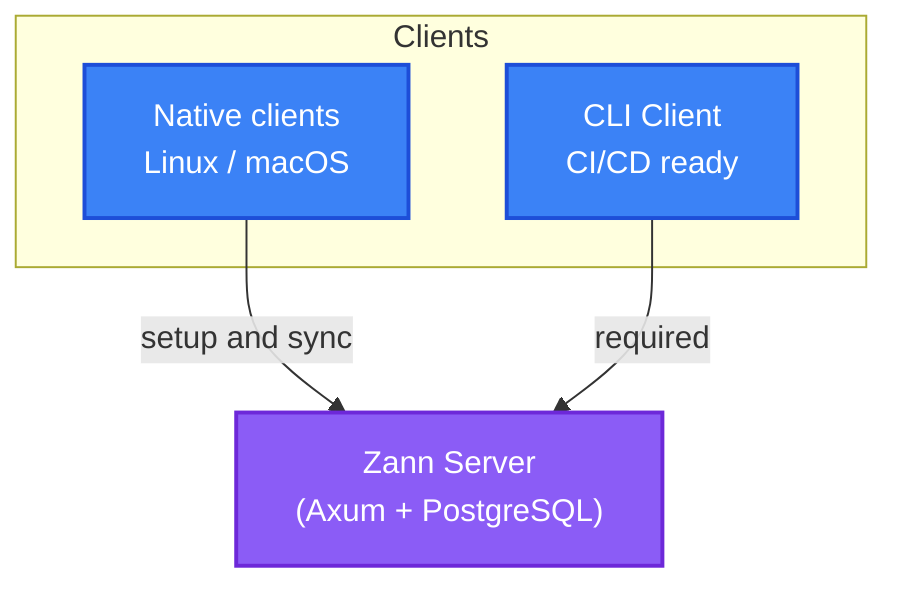

<!-- Generated from README.md. Do not edit this file directly. -->

Self-hosted password manager for individuals and small teams.

> **Pet Project Notice**
>
> This project:
> - Is a pet project for experiments
> - Has a codebase written with LLM assistance
> - **Has not passed a security audit**
> - **Is not recommended for production**
>
> Use at your own risk for testing and learning.

## Native clients

COSMIC on Linux, showing the synthetic offline demo vault:


Build guides: [Linux (COSMIC)](https://github.com/constXife/zann/tree/main/apps/cosmic) · [macOS (SwiftUI)](https://github.com/constXife/zann/tree/main/apps/apple).

## Features

- **Client-side encryption** - personal vaults are encrypted on the client
- **Shared vaults** - shared vaults for small teams
- **CI/CD CLI** - service account tokens, server fingerprint pinning
- **Native clients** - COSMIC on Linux and SwiftUI on macOS, with server-connected setup and encrypted offline replicas
- **Hybrid auth** - OIDC + built-in authentication

## Stability

**Current status:** experimental. Until **v0.Y** (refactor milestone), the API,
CLI, and config format may change without backward compatibility.

### Policy starts at v0.Y

After the refactor milestone, we will publish a stability policy and follow it
for:
- API compatibility
- Config format migrations
- Client/server version support windows

### Breaking changes (pre-policy phase)

- May happen without migration steps
- Are marked in pull request titles and descriptions

## Quick start

For a server-free Linux UI preview, use the [offline demo fixture](https://github.com/constXife/zann/tree/main/apps/cosmic#offline-ui-preview-no-server).
For normal setup, start a server first:

### 1. Start a server

The bundled `compose.yaml` is a local development quickstart, not a production
setup. For real self-hosting start from `config/config.example.yaml` and supply
your own secrets.

```bash
# Clone the repo
git clone https://github.com/constXife/zann
cd zann

# Generate .env with private permissions and random peppers, then build and start
./scripts/dev-up.sh
# Or, with just installed: just dev-up

# The server is available at http://localhost:8080
```

Requires Docker Engine / Docker Desktop with Compose, Bash and OpenSSL. For
Podman with a Compose provider, use `just dev-up podman` or
`./scripts/dev-up.sh podman`. Subsequent starts reuse `.env`; it stays `0600`
and gitignored. Once `.env` exists, `docker compose up -d` also works directly.

PostgreSQL lives in the `zann_pgdata` named volume. The shared-vault master key
(`/data/smk`) and server identity (`/data/identity-key`) are generated in the
`zann_data` named volume, writable by the image's nonroot user. Back up both
volumes and `.env`; see [backup instructions](/install/#local-dev-backups).
If upgrading an existing checkout using `./data`, copy its keys into `zann_data`
before starting the new stack; existing bind-mount data is not moved automatically.

### 2. Build and run a native client

- [COSMIC on Linux](https://github.com/constXife/zann/tree/main/apps/cosmic): Nix package or a source build with
  documented Ubuntu/Debian, Fedora and Arch dependencies.
- [SwiftUI on macOS](https://github.com/constXife/zann/tree/main/apps/apple): Apple silicon, Xcode, Rust, `jq`
  and XcodeGen. Local builds need only the macOS SDK; iOS packaging is opt-in.

On Linux with Nix, from the repository root:

```bash
nix build .#zann-cosmic
./result/bin/zann-cosmic
```

### 3. Connect and create your vault

Connect to `http://localhost:8080` (or your existing server), sign in or register,
then create/unlock your personal vault with its master password and complete the
first sync.

After that, unlock, read, search, edit, export, snapshot and verify work offline.
Edits stay pending until the server confirms them. Forgetting a connection keeps
its encrypted cache and unsent changes; reconnect to resume syncing.
Standalone serverless vault creation is no longer supported. Before upgrading an
old local-only vault, see [the cutover guide](docs/migrations/server-first-clients.md).

Native clients are currently built from source; this repository does not yet
publish GUI installers or a CLI binary release workflow. Windows GUI support is
planned. Full setup instructions: [Install Guide](/install/).

## System requirements (server)

- Minimum (dev / low-load): 1 vCPU, 128 MB RAM
- Recommended (sustained load): 2 vCPU, 512 MB RAM
- Actual requirements depend on RPS, vault size, and cache policy

## Architecture



Components:
- `zann-server` - HTTP API (Axum, PostgreSQL)
- `zann-cli` - CLI client for Linux/macOS/CI
- `apps/cosmic` - native Linux client (libcosmic)
- `apps/apple` - SwiftUI macOS client over UniFFI; iOS/iPadOS planned
- `zann-client` / `zann-client-sqlite` - shared application services and encrypted local replicas
- `zann-ui-core` - shared presentation, editor and generator policy
- `zann-core` / `zann-crypto` - domain models and cryptographic primitives

Server threat model: [crates/zann-server/SECURITY.md](crates/zann-server/SECURITY.md) (assumptions and trust boundaries).

## Usage overview

### General

- Desktop is the primary client for people (personal vaults + shared vaults).
- CLI is for automation and CI/CD; it is token-based and requires the server.
- Server provides the API, shared vaults, and token issuance.

### Desktop

- Connect to a server for setup and sync; use encrypted vault replicas offline.
- Recommended for interactive use and day-to-day management.

### CLI (token-based)

- Uses tokens issued by the server (service account tokens).
- Provide tokens via `--token-file`, `ZANN_SERVICE_TOKEN`, or a stored context.
- Token values are not accepted as command-line arguments.
- Print version info with `zann version`.

Example token creation and CLI setup:

```bash
# Create a service account token on the server
zann-server token create ci-prod infra:/

# Configure the CLI in your CI job
zann config set-context ci \
  --addr https://zann.example.com \
  --token-file /run/secrets/zann-service-account-token \
  --vault infra
```

### Server

- Runs as the shared backend (Docker Compose or a self-hosted source build).
- Issues tokens and enforces access scope and IP restrictions.

## For DevOps and CI/CD

Zann supports CI/CD integrations:

- **Service account tokens** for automation
- **Prefix-based access control** to limit access
- **Server fingerprint pinning** to prevent MITM attacks
- **CLI commands** like `zann secret get services/api/key --vault infra` for scripts
- **NixOS/systemd delivery** with generation-consistent credential files

Service token + CLI example:

```bash
# 1) Create a service account token on the server
zann-server token create ci-prod infra:/
# Mount the "token" output from your CI secret store as a private file

# 2) Configure the CLI in your CI job
zann config set-context ci \
  --addr https://zann.example.com \
  --token-file /run/secrets/zann-service-account-token \
  --vault infra

# 3) Fetch a machine secret value
zann secret get services/api/key --vault infra
```

See [Machine Secrets](docs/Machine-Secrets.md) for the API and operating model,
and [NixOS Secret Delivery](docs/NixOS-Delivery.md) for the fail-closed systemd
adapter.

## Performance baseline

From a local k6 "morning sync" run (~500 VUs, ~2.5k req/s):
- **RSS memory**: ~100 MiB
- **Errors**: no 5xx observed

CPU usage depends on workload and database performance. See [loadtest/k6/scenarios/morning_sync.js](loadtest/k6/scenarios/morning_sync.js) for the scenario.

## Tech stack

**Backend**: Rust, Axum, PostgreSQL, SQLx, Argon2id, ChaCha20Poly1305
**Native clients**: Rust/libcosmic on Linux; SwiftUI + UniFFI on macOS
**DevOps**: Docker Compose, GitHub Actions, Prometheus, OpenTelemetry

## Development

See [CONTRIBUTING.md](CONTRIBUTING.md) for local development instructions.

## License

MIT License - see [LICENSE](LICENSE)

Copyright 2025 constXife
